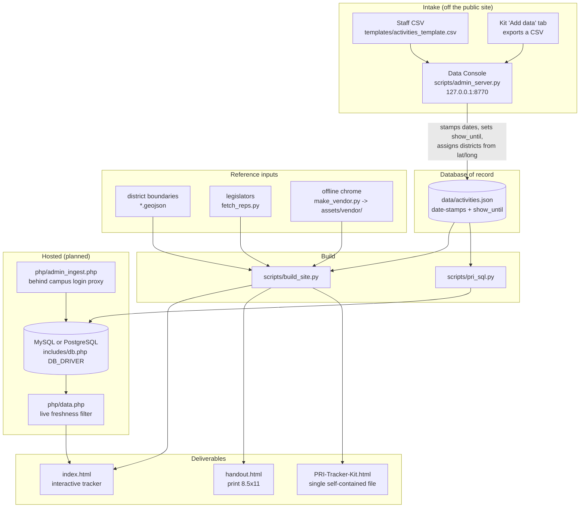

# Architecture

The tracker turns one curated dataset into three deliverables. Everything is built by
plain Python (standard library only) and renders with **no internet connection**.

## Components

| Component | What it does |
|---|---|
| `scripts/pri_data.py` | Shared data layer: load/save, the freshness rule, and lat/long → district assignment (ray-casting point-in-polygon against the geojson). |
| `scripts/admin_server.py` + `admin_ui.html` | The Data Console. Standard-library HTTP server bound to `127.0.0.1` only, never linked from the public pages. Add/edit records, bulk-import CSV, retire, and publish. |
| `scripts/build_site.py` | Builds all three deliverables. Filters out expired records, inlines the offline bundle, and emits `data.js` + `data/geo.json`. |
| `scripts/make_vendor.py` | Run once while online. Vendors the Illinois toolkit, fonts and brand assets into `assets/vendor/`, rewriting every external URL to a `data:` URI. |
| `scripts/pri_sql.py` | Exports `activities.json` to `sql/data.sql` (MySQL) or `sql/data.pgsql.sql` (PostgreSQL) as an idempotent upsert. |
| `tools/migrate.php`, `migrations/` | Numbered schema migrations for both engines with checksums in `schema_migrations`. |
| `tools/load-pg.php` | Loads `activities.json` into PostgreSQL and verifies every field of every row and a checksum. |
| `scripts/studio.py` | The Studio: the application's own source, editable from the Console's *Code & scripts* tab, so someone other than the original author can fix it. Confined, syntax-checked, reversible and logged. |
| `php/`, `includes/` | The hosted layer: `data.php` serves the live, freshness-filtered dataset; `admin_ingest.php` is the back-office ingest page behind the campus login proxy; every query goes through `includes/db.php`. |

## Main workflows

**Adding data.** A staff member fills in the intake CSV (or the Kit's *Add data* tab,
which exports the same shape). The data manager imports it in the Data Console, which
date-stamps each record, sets its display timer, and assigns legislative districts
from latitude/longitude. Publish rebuilds the site.

**The display timer.** A record shows only while `show_until` is blank (evergreen) or
still in the future. The build filters expired records out of `data.js`, and a small
client-side guard drops anything that expires between rebuilds. Once hosted,
`php/data.php` applies the same rule live, so records expire with no rebuild at all.

**Offline rendering.** No deliverable fetches anything at render time. See
`AGENTS.md` for the two traps (module scope, and linked-vs-inline modules on
`file://`) and the forced-offline verification command.

## Known risks

1. **The database of record is a single JSON file on a synced network share.**
   `.claude/skills/pri-database` warns against this: two people editing at once can
   overwrite each other. *Mitigated, not solved* — `pri_data.save_db()` fingerprints
   the file on load and refuses to write if it changed underneath, so a second saver
   is told to reload instead of silently clobbering the first, and the console warns
   when a sync conflict copy appears. The real fix is Postgres on the Radiant VM;
   until then, prefer one editor at a time.
2. **Backups.** `py scripts/backup_data.py` writes a verified snapshot and prunes
   old ones (30 daily, then monthly). *This must actually be scheduled* — see
   README. Point `PRI_BACKUP_DIR` at somewhere outside the synced folder so a sync
   problem cannot take the backups with it. Without it, `scripts/app_config.py`
   puts `backups/` (snapshots and the Studio's copies and history.log) in the
   `dataFolder` that the git-ignored `config.local.json` names; on the drive,
   SETUP.bat sets that to `..\..\data\pri-district-tracker`. With no dataFolder,
   `backups/` stays beside the project.
3. **Tests.** `py scripts/run_tests.py` covers the freshness rule, district
   assignment, the CSV round-trip, the concurrency guard, backup retention and the
   offline guarantee. `.github/workflows/checks.yml` runs them on every push and
   also fails the build on a hardcoded-looking credential.

## Security notes

- **API keys have one door and the tracker needs none.** `scripts/keys.py` opens a
  separate, git-ignored SQLite database in the drive data folder
  (`scripts/app_config.py::keys_db()`, today `..\..\data\pri-district-tracker\keys.db`),
  so a key can never reach `data/activities.json`, `sql/data.sql`, a backup snapshot or
  the port to PostgreSQL. No key is held today: `scripts/fetch_reps.py` reads the Open
  States **public bulk roster**, which takes none, and district assignment is local
  point-in-polygon. Credentials for a database server stay in the environment, named in
  `.env.example`. No function prints a value, and `--list` reports names and dates only.

- The Data Console binds to `127.0.0.1` **and** requires a per-run token on every
  `/api/` call, plus Host and Origin checks. Localhost binding alone does not stop a
  cross-site POST from a page in the same browser - and the Studio writes code the next
  build runs, so that would have been a way onto the machine.
- A Studio restore only accepts a backup whose name belongs to the file being restored,
  so one file's copy cannot be written over another.
- If the console is ever exposed beyond localhost it needs real authentication (the
  campus login proxy) and the Studio needs its own access grant, as in PRI Facilities.

## Still open

- Move to Postgres on the Radiant VM (removes risk 1 entirely, and lets the hosted
  `php/` layer serve live data with the timer applied server-side).
- Register an OIDC client for Campus AD / CILogon with ODSC so the login proxy in
  front of `php/admin_ingest.php` can be switched on.
